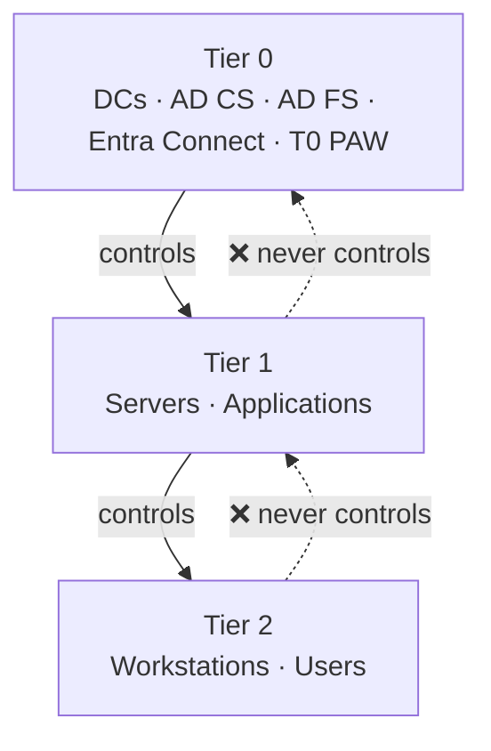
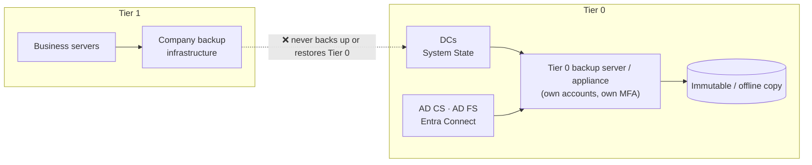

# Active Directory Tiering — A Practical Guide

> A hands-on tutorial to understand and implement the Active Directory tier model (Tier 0 / Tier 1 / Tier 2): concepts, rollout plan, PowerShell and GPO examples, tips and common pitfalls.

**Disclaimer:** every script below is an example. Run it in a lab first, adapt names and OU paths to your environment, and always keep a tested AD backup before changing Tier 0.

---

## Table of contents

1. [Why tiering?](#1-why-tiering)
2. [The tier model in a nutshell](#2-the-tier-model-in-a-nutshell)
3. [Golden rules](#3-golden-rules)
4. [Step 0 — Scope your Tier 0](#4-step-0--scope-your-tier-0)
5. [Step 1 — OU structure and naming convention](#5-step-1--ou-structure-and-naming-convention)
6. [Step 2 — Dedicated admin accounts and groups](#6-step-2--dedicated-admin-accounts-and-groups)
7. [Step 3 — Logon restrictions with GPO](#7-step-3--logon-restrictions-with-gpo)
8. [Step 4 — Authentication Policies and Silos](#8-step-4--authentication-policies-and-silos)
9. [Step 5 — Privileged Access Workstations (PAW)](#9-step-5--privileged-access-workstations-paw)
10. [Step 6 — Extra hardening (Protected Users, LAPS, delegation, hybrid)](#10-step-6--extra-hardening)
11. [Step 7 — Backup and recovery](#11-step-7--backup-and-recovery)
12. [Step 8 — Monitor and audit (with a Wazuh example)](#12-step-8--monitor-and-audit)
13. [Step 9 — Validate like an attacker](#13-step-9--validate-like-an-attacker)
14. [Rollout plan](#14-rollout-plan)
15. [Common pitfalls](#15-common-pitfalls)
16. [Checklist](#16-checklist)
17. [References](#17-references)

---

## 1. Why tiering?

The classic AD compromise looks like this:

1. A user's workstation gets phished.
2. The attacker becomes local admin on it.
3. A helpdesk or **Domain Admin** account has logged on to that workstation, so its credentials are in memory (NTLM hash, Kerberos TGT).
4. The attacker dumps them (Mimikatz, LSASS dump…), and the domain is gone.

Tiering breaks this chain. The goal is not to stop the first compromise. **It makes sure a highly privileged credential never shows up on a less trusted machine.**

---

## 2. The tier model in a nutshell

| Tier | Also called | Contains | Examples |
|---|---|---|---|
| **Tier 0** | Control plane, "trusted core" | Everything that controls identities in the forest | Domain controllers, AD DS, AD CS / PKI, AD FS, Entra Connect, Tier 0 PAWs, Tier 0 admin accounts, any tool that can manage the above |
| **Tier 1** | Management / workload plane | Servers and business applications | File servers, SQL, ERP, application servers, their admins |
| **Tier 2** | User access | End-user devices and support | Workstations, laptops, helpdesk accounts |



Plain arrows: a higher tier may manage the tier below. Dotted arrows: a lower tier must never have control over a higher one. Credentials follow the opposite rule: a higher-tier account never logs on to a lower-tier machine.

> **Note:** Microsoft now calls this the *legacy* tier model and recommends the **Enterprise Access Model** (control plane / management plane / data-workload plane / user and app access) for hybrid and cloud environments. For on-prem AD, the 3-tier model is still the reference, including in ANSSI's guide PA-099.

---

## 3. Golden rules

1. **Control flows down, never up.** A Tier 0 admin may manage Tier 1, but a Tier 1 account must never have any control over Tier 0.
2. **Credentials never go down.** A Tier *N* account never logs on to a Tier *N+1* machine, whether by RDP, interactive logon, `runas`, scheduled task or service.
3. **One person = one account per tier.** `alice` (daily use, no privileges), `adm-t1-alice` and `adm-t0-alice`.
4. **The keyboard sets the trust level.** A Tier 0 session opened from a Tier 2 workstation is a Tier 2 session. Admin from a PAW of the same tier.
5. **Anything that controls a Tier 0 asset is Tier 0.** That includes backup, hypervisors, EDR consoles, patching, monitoring agents with SYSTEM rights…

---

## 4. Step 0 — Scope your Tier 0

This is the most important step and the one most often underestimated. Before creating any OU, list **everything that can take control of a DC or of AD**:

- [ ] Domain controllers (and RODCs)
- [ ] AD CS / PKI servers (ESC1–ESC8 attacks make AD CS Tier 0)
- [ ] AD FS, Entra Connect / Cloud Sync agents
- [ ] Hypervisors and their management consoles hosting DCs (vCenter, Hyper-V hosts…)
- [ ] Backup servers that back up DCs
- [ ] Deployment / patching tools that push to DCs (SCCM/MECM, WSUS if it targets DCs, Ansible…)
- [ ] EDR / AV consoles that can run scripts on DCs (*yes, your EDR console is Tier 0*)
- [ ] Monitoring / SIEM agents running as SYSTEM on DCs, if their server can push config or commands
- [ ] PAM / password vaults storing Tier 0 credentials
- [ ] Members of privileged groups: Domain Admins, Enterprise Admins, Schema Admins, Administrators, Account Operators, Backup Operators, Server Operators, Print Operators, DnsAdmins, Group Policy Creator Owners
- [ ] GPOs linked to DCs or to the domain root, and whoever can edit them

> 💡 **Tip:** use **BloodHound** (or the ANSSI tools ORADAD/ADS, or PingCastle) to find *control paths* to Tier 0: ACLs, GPO rights, nested groups, delegation. If a Tier 1 group has `GenericWrite` on a Tier 0 object, that group is effectively Tier 0.

> 💡 **Tip:** **keep Tier 0 small.** Every asset you put in Tier 0 has to be protected at Tier 0 level. When possible, move it out (for example, back up DCs with a dedicated Tier 0 backup instance rather than the company-wide backup server).

Quick inventory of privileged group members:

```powershell
$privGroups = @(
  "Domain Admins","Enterprise Admins","Schema Admins","Administrators",
  "Account Operators","Backup Operators","Server Operators","Print Operators",
  "DnsAdmins","Group Policy Creator Owners"
)

$privGroups | ForEach-Object {
  $g = $_
  Get-ADGroupMember -Identity $g -Recursive -ErrorAction SilentlyContinue |
    Select-Object @{n='Group';e={$g}}, Name, SamAccountName, objectClass
} | Format-Table -AutoSize
```

---

## 5. Step 1 — OU structure and naming convention

A clear OU tree is what lets you target GPOs and delegations per tier.

```
DC=corp,DC=local
├── OU=Tier 0
│   ├── OU=Accounts          (adm-t0-*)
│   ├── OU=Groups
│   ├── OU=Service Accounts
│   ├── OU=Servers           (AD CS, AD FS, Entra Connect…)
│   └── OU=PAW
├── OU=Tier 1
│   ├── OU=Accounts          (adm-t1-*)
│   ├── OU=Groups
│   ├── OU=Service Accounts
│   ├── OU=Servers
│   └── OU=PAW
├── OU=Tier 2
│   ├── OU=Accounts          (adm-t2-* / helpdesk)
│   ├── OU=Groups
│   ├── OU=Service Accounts
│   ├── OU=Workstations
│   └── OU=PAW
└── OU=Users                 (standard, non-privileged users)
```

Domain controllers stay in the built-in `OU=Domain Controllers`, which is part of Tier 0 by definition.

```powershell
$domainDN = (Get-ADDomain).DistinguishedName
$tiers    = "Tier 0","Tier 1","Tier 2"
$subOUs   = "Accounts","Groups","Service Accounts","PAW"

foreach ($t in $tiers) {
  New-ADOrganizationalUnit -Name $t -Path $domainDN -ProtectedFromAccidentalDeletion $true
  $tierDN = "OU=$t,$domainDN"
  foreach ($s in $subOUs) {
    New-ADOrganizationalUnit -Name $s -Path $tierDN -ProtectedFromAccidentalDeletion $true
  }
}
New-ADOrganizationalUnit -Name "Servers"      -Path "OU=Tier 0,$domainDN"
New-ADOrganizationalUnit -Name "Servers"      -Path "OU=Tier 1,$domainDN"
New-ADOrganizationalUnit -Name "Workstations" -Path "OU=Tier 2,$domainDN"
New-ADOrganizationalUnit -Name "Quarantine"   -Path $domainDN
```

**Close the back doors before anything else:**

```powershell
# 1. By default any authenticated user can join 10 computers to the domain. Set it to 0
#    and delegate "Create computer objects" only on the right OUs to the right tier group.
Set-ADDomain -Identity (Get-ADDomain) -Replace @{"ms-DS-MachineAccountQuota" = "0"}

# 2. New computers land in CN=Computers (outside any tier, no GPO). Redirect them to a quarantine OU
#    that only receives a restrictive baseline GPO until someone moves them to the right tier.
redircmp "OU=Quarantine,$((Get-ADDomain).DistinguishedName)"
```

**Naming convention (example):**

| Object | Pattern | Example |
|---|---|---|
| Admin account | `adm-t<N>-<user>` | `adm-t0-alice` |
| Service account | `svc-t<N>-<app>` | `svc-t1-sqlprod` |
| gMSA | `gmsa-t<N>-<app>` | `gmsa-t1-iis01$` |
| Group | `T<N>-<role>` | `T1-Server-Admins` |
| PAW | `PAW-T<N>-<id>` | `PAW-T0-01` |

> ⚠️ gMSA (like computer accounts) are limited to **15 characters** for the `sAMAccountName` (without the trailing `$`). Keep the application part short: `gmsa-t1-` already uses 8.

> 💡 **Tip:** a consistent prefix makes audits trivial: `Get-ADUser -Filter "SamAccountName -like 'adm-t0-*'"`.

---

## 6. Step 2 — Dedicated admin accounts and groups

```powershell
$domainDN = (Get-ADDomain).DistinguishedName

# Tier groups
New-ADGroup -Name "T0-Admins"         -GroupScope Global -Path "OU=Groups,OU=Tier 0,$domainDN"
New-ADGroup -Name "T1-Server-Admins"  -GroupScope Global -Path "OU=Groups,OU=Tier 1,$domainDN"
New-ADGroup -Name "T2-Helpdesk"       -GroupScope Global -Path "OU=Groups,OU=Tier 2,$domainDN"

# Tier 1 admin account for Alice
New-ADUser -Name "adm-t1-alice" -SamAccountName "adm-t1-alice" `
  -Path "OU=Accounts,OU=Tier 1,$domainDN" `
  -AccountPassword (Read-Host -AsSecureString "Password") `
  -Enabled $true -PasswordNeverExpires $false

Add-ADGroupMember -Identity "T1-Server-Admins" -Members "adm-t1-alice"

# Never delegated, whatever the tier
Set-ADAccountControl -Identity "adm-t1-alice" -AccountNotDelegated $true
```

Then give each group local admin rights **only on its tier**, using a GPO linked to that tier's computer OU:

- `Computer Configuration > Preferences > Control Panel Settings > Local Users and Groups`
  - Tier 1 servers GPO → add `T1-Server-Admins` to `Administrators (built-in)`
  - Tier 2 workstations GPO → add `T2-Helpdesk` to `Administrators (built-in)`

> ⚠️ **Domain Admins is added to the local Administrators group of every machine when it joins the domain.** The deny GPOs of step 3 stop DA accounts from logging on, but clean it up anyway. In the GPP *Local Group* item (*Update* action on `Administrators (built-in)`), tick **"Delete all member groups"** and list the groups that must stay (the tier admin group). `Domain Admins` is then removed at the next refresh. The built-in local Administrator account is a user, so it is kept (and managed by LAPS, see step 6). Test on a pilot OU first: a wrong GPP here can remove every admin from the machine.

> 💡 **Tip:** Tier 0 admins do **not** need to be local admins on Tier 1/2 machines. If a Tier 0 admin must manage a Tier 1 server, they use their `adm-t1-*` account.

> 💡 **Tip:** not every Tier 0 account needs to be in Domain Admins. Delegate precise rights (for example, managing a given OU) instead of granting DA "just in case".

---

## 7. Step 3 — Logon restrictions with GPO

This is the core of the "credentials never go down" rule. It is enforced with **User Rights Assignment** settings:

`Computer Configuration > Policies > Windows Settings > Security Settings > Local Policies > User Rights Assignment`

| Setting | Constant |
|---|---|
| Deny log on locally | `SeDenyInteractiveLogonRight` |
| Deny log on through Remote Desktop Services | `SeDenyRemoteInteractiveLogonRight` |
| Deny access to this computer from the network | `SeDenyNetworkLogonRight` |
| Deny log on as a batch job | `SeDenyBatchLogonRight` |
| Deny log on as a service | `SeDenyServiceLogonRight` |

**Matrix (who is denied where):**

| GPO linked to… | Deny these groups | Which rights |
|---|---|---|
| Tier 1 servers (`OU=Servers,OU=Tier 1`) | Tier 0 accounts (`T0-Admins`, Domain Admins, Enterprise Admins…) **and** Tier 2 admins | All 5 |
| Tier 2 workstations (`OU=Workstations,OU=Tier 2`) | Tier 0 accounts **and** Tier 1 admins | All 5 |
| Tier 0 servers and T0 PAW (`OU=Servers,OU=Tier 0`, `OU=PAW,OU=Tier 0`) | Tier 1 and Tier 2 admin groups | All 5 |
| **Domain controllers** (`OU=Domain Controllers`) | Tier 1 and Tier 2 admin groups | **Local, RDP, batch, service only — NOT network** |

> ⚠️ **Do not deny network access to the DCs for Tier 1/Tier 2 accounts.** Every domain account needs network access to a DC to read `SYSVOL`/`NETLOGON` (GPO processing, logon scripts). If you deny it, `adm-t1-*` accounts lose their user GPOs on the servers they manage. On DCs, deny only interactive, RDP, batch and service logons for lower tiers.

> ⚠️ **Watch out for "Deny access from the network".** It blocks SMB, WinRM, remote MMC… for those accounts. It is exactly what you want for higher-tier accounts on lower-tier machines, but check that no legitimate Tier 0 tool authenticates that way first (for example, a backup or monitoring agent using a DA account — which is itself a problem to fix).

> ⚠️ **Never put the built-in `Administrators` group (or `BUILTIN\Administrators`) in a Deny setting.** On a member server it resolves to the *local* Administrators group, so you would block the tier's own admins and the local admin account. Deny the domain groups explicitly (`Domain Admins`, `Enterprise Admins`, `Schema Admins`, `T0-Admins`…).

> ⚠️ **Never** apply the Tier 0 deny GPO to the `Domain Controllers` OU with Tier 0 groups in it: you would lock yourself out of your DCs.

> 💡 **Tip:** GPO logon restrictions are a good first layer, but a local admin on the target machine can bypass them, and they only apply to domain-joined Windows machines. That is why the next step (Authentication Policy Silos, enforced by the **KDC**) matters.

---

## 8. Step 4 — Authentication Policies and Silos

Authentication Policy Silos (Windows Server 2012 R2+) let the **domain controller itself** refuse a Kerberos TGT for an account when the request does not come from an allowed machine. For example: `adm-t0-*` accounts can only get a TGT from DCs, Tier 0 servers and Tier 0 PAWs.

> ⚠️ **Which machines must be in the silo?** Every machine where a Tier 0 admin **types or sends** their credentials. That includes the PAW, but also any Tier 0 server reached with a classic RDP session (NLA/CredSSP): the credentials are sent to the target, and the *target* asks the DC for a TGT. If AD CS, AD FS or Entra Connect servers are not in the silo, Tier 0 admins can no longer RDP to them once the silo is enforced. Alternatively, use Remote Credential Guard or Restricted Admin (see step 5): credentials are not sent to the target.

### 8.1 Prerequisites

- Domain functional level **Windows Server 2012 R2** or higher
- Clients and servers in the silo running Windows 8 / Windows Server 2012 or later (they must support Kerberos armoring)
- Kerberos armoring (FAST) enabled:
  - **On DCs:** `Computer Configuration > Policies > Administrative Templates > System > KDC > KDC support for claims, compound authentication and Kerberos armoring` → *Enabled*, option *Supported*
  - **On clients (PAW, servers):** `Computer Configuration > Policies > Administrative Templates > System > Kerberos > Kerberos client support for claims, compound authentication and Kerberos armoring` → *Enabled*

### 8.2 Create the policy and the silo (in **audit** mode first)

```powershell
# 1. Authentication policy: TGT limited to 4h, only from devices that belong to the T0 silo
New-ADAuthenticationPolicy -Name "T0-AuthPolicy" `
  -Description "Tier 0 accounts - logon only from T0 silo devices" `
  -UserTGTLifetimeMins 240 `
  -UserAllowedToAuthenticateFrom 'O:SYG:SYD:(XA;OICI;CR;;;WD;(@USER.ad://ext/AuthenticationSilo == "T0-Silo"))' `
  -ProtectedFromAccidentalDeletion $true

# 2. Silo, in AUDIT mode (no -Enforce)
#    The same policy is reused for users, computers and services to keep the example short:
#    only its User* settings restrict anything here. In production, one policy per object type
#    (T0-Users, T0-Computers, T0-Services) is easier to read and to tune.
New-ADAuthenticationPolicySilo -Name "T0-Silo" `
  -UserAuthenticationPolicy     "T0-AuthPolicy" `
  -ComputerAuthenticationPolicy "T0-AuthPolicy" `
  -ServiceAuthenticationPolicy  "T0-AuthPolicy" `
  -ProtectedFromAccidentalDeletion $true
```

### 8.3 Add accounts and devices to the silo

A member must be **both** allowed in the silo (`Grant-…Access`) **and** assigned to it (`-AuthenticationPolicySilo`).

```powershell
# Tier 0 admin accounts
Get-ADUser -Filter "SamAccountName -like 'adm-t0-*'" | ForEach-Object {
  Grant-ADAuthenticationPolicySiloAccess -Identity "T0-Silo" -Account $_
  Set-ADUser -Identity $_ -AuthenticationPolicySilo "T0-Silo"
}

# Domain controllers + Tier 0 servers + Tier 0 PAWs
# @() forces an array: without it, a single-DC domain returns one object and "+=" fails
$domainDN     = (Get-ADDomain).DistinguishedName
$t0Computers  = @(Get-ADDomainController -Filter * | ForEach-Object { Get-ADComputer -Identity $_.ComputerObjectDN })
$t0Computers += @(Get-ADComputer -SearchBase "OU=Servers,OU=Tier 0,$domainDN" -Filter *)
$t0Computers += @(Get-ADComputer -SearchBase "OU=PAW,OU=Tier 0,$domainDN"     -Filter *)

foreach ($c in $t0Computers) {
  Grant-ADAuthenticationPolicySiloAccess -Identity "T0-Silo" -Account $c
  Set-ADComputer -Identity $c -AuthenticationPolicySilo "T0-Silo"
}
```

### 8.4 Watch the audit logs, then enforce

On the DCs, read:
`Applications and Services Logs > Microsoft > Windows > Authentication > AuthenticationPolicyFailures-DomainController`

This log is **disabled by default**. Enable it on every DC first, otherwise the audit period shows nothing:

```powershell
wevtutil sl "Microsoft-Windows-Authentication/AuthenticationPolicyFailures-DomainController" /e:true
```

| Event ID (audit) | Event ID (enforced) | Meaning |
|---|---|---|
| 301 | 101 | NTLM authentication failure (restriction) |
| 305 | 105 | Kerberos TGT restriction failure |
| 306 | 106 | Kerberos service ticket restriction failure |

```powershell
Get-ADDomainController -Filter * | ForEach-Object {
  Get-WinEvent -ComputerName $_.HostName -ErrorAction SilentlyContinue -FilterHashtable @{
    LogName = 'Microsoft-Windows-Authentication/AuthenticationPolicyFailures-DomainController'
    Id      = 301, 305, 306
  } | Select-Object MachineName, TimeCreated, Id, Message -First 50
}
```

When you have a clean audit period (no unexplained 30x event on any DC), switch to enforced:

```powershell
Set-ADAuthenticationPolicy     -Identity "T0-AuthPolicy" -Enforce $true
Set-ADAuthenticationPolicySilo -Identity "T0-Silo"       -Enforce $true
```

> 💡 **Tip:** keep at least one **break-glass** Tier 0 account *outside* the silo. The usual choice is the built-in **Administrator account (RID 500)**: long random password, split or stored offline in a safe, an alert on every use (see step 8). Keep it **out of Protected Users** too, so it still works if Kerberos is broken (NTLM fallback). It remains a Tier 0 account, so the deny GPOs on Tier 1/Tier 2 still apply to it.

> 💡 **Tip:** start with Tier 0 only. Silos for Tier 1/Tier 2 are useful but much harder to operate at scale.

---

## 9. Step 5 — Privileged Access Workstations (PAW)

A PAW is a hardened workstation used **only** for administration of one tier.

Minimum for a Tier 0 PAW:

- [ ] Dedicated hardware (or at least a dedicated, hardened host; never a VM on a user workstation)
- [ ] In `OU=PAW,OU=Tier 0`, managed **only** by Tier 0 GPOs and Tier 0 tools
- [ ] No email, no web browsing to the Internet, no Office macros
- [ ] Application allow-listing (AppLocker / WDAC)
- [ ] Credential Guard, BitLocker, Secure Boot, TPM 2.0
- [ ] Inbound firewall: deny all; outbound: only to Tier 0 targets
- [ ] Member of `T0-Silo` (see step 4)
- [ ] EDR installed, but managed from a console you treat as Tier 0
- [ ] Managed (patching, config, apps) **only** by a Tier 0 tool or Tier 0 admins

> ⚠️ **Whoever manages the PAW is Tier 0.** If Tier 0 PAWs are enrolled in the company-wide Intune or SCCM/MECM, every admin of that console can push code to them and becomes de facto Tier 0. Either manage T0 PAWs with a dedicated Tier 0 instance (separate SCCM site, dedicated Intune scope with strict RBAC and its own admins), or manage them by GPO only.

> 💡 **Tip:** admins still need email and the web. Give them a separate standard device (or a VDI/remote app) with their **non-privileged** account. Never "just this once" on the PAW.

### How to RDP: Remote Credential Guard or Restricted Admin

A classic RDP session (NLA/CredSSP) sends your credentials to the target, and they stay in its LSASS. Inside a tier it is still an exposure: one compromised Tier 1 server exposes every Tier 1 admin who logged on to it.

| Mode | Command | What happens | Caveats |
|---|---|---|---|
| **Remote Credential Guard** (preferred) | `mstsc /remoteGuard` | Kerberos requests are redirected to the client; credentials never reach the target | Kerberos only (use FQDN), client and target Windows 10 1607 / Server 2016+, you cannot reach other servers from the session with your identity |
| **Restricted Admin** | `mstsc /restrictedAdmin` | You are logged on with no credentials on the target; network access uses the target's computer account | Requires local admin on the target; the session itself becomes a pass-the-hash target on the server |

Enable on the targets (servers):

```powershell
# Allows Restricted Admin and Remote Credential Guard connections to this machine
New-ItemProperty -Path "HKLM:\SYSTEM\CurrentControlSet\Control\Lsa" `
  -Name "DisableRestrictedAdmin" -PropertyType DWord -Value 0 -Force
```

Enforce on the PAWs (clients): `Computer Configuration > Policies > Administrative Templates > System > Credentials Delegation > Restrict delegation of credentials to remote servers` → *Enabled*, *Require Remote Credential Guard* (or *Require Restricted Admin*).

> 💡 **Tip:** if you choose Remote Credential Guard for Tier 0 servers, they no longer need to be in the Tier 0 silo for RDP (see step 4). Pick one approach and document it.

> 💡 **Tip:** if you use jump servers for Tier 0, they are Tier 0 assets as well, and you must still reach them **from** a Tier 0 PAW. A jump server reached from a Tier 2 workstation adds network convenience, not security.

> 💡 **Tip (budget mode):** for Tier 1 and Tier 2 admin, a hardened VM on the PAW host or a dedicated admin VDI can be acceptable. For Tier 0, aim for dedicated hardware.

---

## 10. Step 6 — Extra hardening

### Protected Users

Add **human** Tier 0 (and ideally Tier 1) admin accounts to the built-in `Protected Users` group. Effects: no NTLM, no DES/RC4 for Kerberos pre-authentication, no Kerberos delegation, no cached credentials, TGT limited to 4 hours. The DC-side protections (including the 4-hour TGT) require domain functional level Windows Server 2012 R2 or higher.

```powershell
Get-ADUser -Filter "SamAccountName -like 'adm-t0-*'" |
  ForEach-Object { Add-ADGroupMember -Identity "Protected Users" -Members $_ }
```

> ⚠️ Do **not** add service accounts or computer accounts to Protected Users. Test first: anything relying on NTLM for those accounts will break.

> 💡 **Tip — "my admin account is broken":** a Protected Users member cannot use NTLM. RDP or `\\share` access **by IP address** or by a DNS alias without a registered SPN silently falls back to NTLM and fails. Always connect with the **FQDN** (`srv-app01.corp.local`), and test every admin tool (consoles, scripts, third-party tools) before adding accounts.

### Windows LAPS (with per-tier read permissions)

```powershell
Update-LapsADSchema
$domainDN = (Get-ADDomain).DistinguishedName

$lapsScope = @{
  "OU=Servers,OU=Tier 0,$domainDN"      = "T0-Admins"
  "OU=PAW,OU=Tier 0,$domainDN"          = "T0-Admins"
  "OU=Servers,OU=Tier 1,$domainDN"      = "T1-Server-Admins"
  "OU=Workstations,OU=Tier 2,$domainDN" = "T2-Helpdesk"
}

foreach ($ou in $lapsScope.Keys) {
  # Let computers write their own password
  Set-LapsADComputerSelfPermission -Identity $ou
  # Only the right tier can read the passwords
  Set-LapsADReadPasswordPermission -Identity $ou -AllowedPrincipals $lapsScope[$ou]
}
```

Then configure the LAPS GPO: `Computer Configuration > Policies > Administrative Templates > System > LAPS`:

- **Configure password backup directory** → *Active Directory*
- **Enable password encryption** → *Enabled* (requires domain functional level **Windows Server 2016**). Without it, the password is stored in clear text in the attribute, readable by anyone with the read right.
- On a GPO linked to `OU=Domain Controllers`: **Enable password backup for DSRM accounts** → *Enabled*. Windows LAPS then manages and rotates the DSRM password of each DC, which is otherwise often set once at promotion and never changed.

### Delegation and Kerberos

- Mark all admin accounts **"Account is sensitive and cannot be delegated"** (done in step 2).
- Hunt unconstrained delegation outside DCs:

```powershell
Get-ADComputer -Filter {TrustedForDelegation -eq $true -and PrimaryGroupID -ne 516} |
  Select-Object Name, DistinguishedName
```

- Avoid SPNs on Tier 0 user accounts (Kerberoasting). Use **gMSA** for service accounts.

### GPO and ACL hygiene

- Only Tier 0 can edit GPOs linked to Tier 0 OUs or the domain root.
- Review ACLs on Tier 0 OUs, `AdminSDHolder` and the domain object regularly (BloodHound, PingCastle, ORADAD).

### Hybrid environments (Entra ID)

On-prem tiering is useless if the cloud side reopens the path:

- **Do not synchronise Tier 0 accounts to Entra ID.** Exclude `OU=Tier 0` (at least `OU=Accounts`) from the Entra Connect / Cloud Sync scope. An `adm-t0-*` account synced to the cloud can be reset or phished there.
- **Cloud admins (Global Administrator, Privileged Role Administrator…) are cloud-only accounts**, never synced from AD, protected by phishing-resistant MFA and PIM.
- **The Entra Connect server and its service accounts are Tier 0**: whoever controls them controls both AD (password writeback, permissions on AD) and Entra ID.
- **Cloud roles that can manage on-prem assets** (Intune admins for PAWs or DCs, Defender for Endpoint "live response" on DCs, Azure Arc on DCs) are part of Tier 0 too.

### Going further (ANSSI "R+" level)

For mature environments:

- **Smart card or Windows Hello for Business required** for Tier 0 accounts (`Smart card is required for interactive logon`), with periodic NTLM hash rotation.
- **Fine-Grained Password Policies** (FGPP) for admin and service accounts: longer passwords, stricter lockout.
- **Regular `krbtgt` rotation** (twice, with replication time between the two resets), at least yearly and after any suspected compromise.
- **Just-in-time membership** of privileged groups (time-bound membership with the PAM optional feature, or a PAM solution) instead of permanent Domain Admins.

---

## 11. Step 7 — Backup and recovery

Backup is the most common way around a tiering model. **A backup of a domain controller contains `ntds.dit`, so the password hash of every account in the domain, `krbtgt` included.** Whoever can read, copy or restore that backup owns the domain, without ever logging on to a DC.

Ransomware operators know it: they target the backup console first, then encrypt. A tiering project must therefore answer three questions: who can touch DC backups, can the attacker who owns AD also destroy the backups, and can you actually restore.

### 11.1 Architecture: one backup chain per trust level



| Rule | Why |
|---|---|
| **Dedicated Tier 0 backup** (separate server, appliance, or at least a separate instance with its own console) for DCs and Tier 0 servers | The company-wide backup console has dozens of admins and agents everywhere: it cannot be Tier 0 |
| **Backup admin accounts not in AD**, or Tier 0 accounts only | If the backup console authenticates against the AD it protects, owning AD = owning backups |
| **MFA on the backup console that does not depend on AD** | Same reason |
| **Backup server not joined to the production domain**, or joined and protected as Tier 0 | A domain-joined backup server is administered by Domain Admins and reachable by AD-based attacks |
| **At least one immutable or offline copy** (WORM / object lock, tape, air-gapped) | Immutable means even a backup admin cannot delete it before retention ends |
| **Hypervisor-level backups and snapshots of DC VMs are Tier 0** | A VMDK/VHDX of a DC contains `ntds.dit` just like a System State backup |

> 💡 **Tip:** the Tier 1 backup can still back up the *file system* of Tier 1 servers. What matters is that nothing from Tier 1 can **read** DC backups or **restore** onto Tier 0.

### 11.2 What to back up

| Item | How | Frequency (example) |
|---|---|---|
| **System State of at least two DCs per domain** (ideally all, including one holding the FSMO roles) | Windows Server Backup or the Tier 0 backup tool | Daily |
| **AD CS** (CA database **and private key**) | `Backup-CARoleService` / `certutil -backup` | Daily (database), at each change (key) |
| **GPOs** | `Backup-GPO -All` | Daily, and before every change |
| **DNS zones** (if not AD-integrated) | `Export-DnsServerZone` / `dnscmd /zoneexport` | Daily |
| **Entra Connect configuration** | Export via the wizard, or keep the documented config | At each change |
| **DSRM passwords** | Windows LAPS (step 6), plus a copy **outside AD** (safe) | At rotation |

> ⚠️ **Tombstone lifetime.** A DC backup older than the tombstone lifetime (180 days by default on recent forests) cannot be restored safely. Check yours: `(Get-ADObject "CN=Directory Service,CN=Windows NT,CN=Services,$((Get-ADRootDSE).configurationNamingContext)" -Properties tombstoneLifetime).tombstoneLifetime`. Keep several recent backups rather than one very old one.

### 11.3 Example: System State backup with a gMSA

Windows Server Backup is enough for a small environment, and it is useful to understand what any backup tool does under the hood.

```powershell
# --- On a Tier 0 admin PAW ---
$domainDN = (Get-ADDomain).DistinguishedName

# KDS root key, required once per forest for gMSA (see the warning below about the delay)
if (-not (Get-KdsRootKey)) { Add-KdsRootKey -EffectiveImmediately }

# gMSA used only for DC backups, password retrievable only by the DCs
New-ADServiceAccount -Name "gmsa-t0-bkp" `
  -DNSHostName "gmsa-t0-bkp.$((Get-ADDomain).DNSRoot)" `
  -PrincipalsAllowedToRetrieveManagedPassword "Domain Controllers" `
  -Path "OU=Service Accounts,OU=Tier 0,$domainDN"

# Backup Operators gives the right to back up DCs. Keep this gMSA as its ONLY member.
Add-ADGroupMember -Identity "Backup Operators" -Members (Get-ADServiceAccount "gmsa-t0-bkp")
```

> ⚠️ `Add-KdsRootKey -EffectiveImmediately` still waits 10 hours before the key can be used in production (to let it replicate). In a single-DC lab only, you can use `-EffectiveTime ((Get-Date).AddHours(-10))`.

```powershell
# --- On each DC ---
Install-WindowsFeature Windows-Server-Backup
Install-ADServiceAccount -Identity "gmsa-t0-bkp"
Test-ADServiceAccount   -Identity "gmsa-t0-bkp"   # must return True

# Daily System State backup to a dedicated local volume (E:), run as the gMSA
$action    = New-ScheduledTaskAction -Execute "wbadmin.exe" `
               -Argument "start systemstatebackup -backupTarget:E: -quiet"
$trigger   = New-ScheduledTaskTrigger -Daily -At 2am
$principal = New-ScheduledTaskPrincipal -UserId "$((Get-ADDomain).NetBIOSName)\gmsa-t0-bkp$" `
               -LogonType Password -RunLevel Highest

Register-ScheduledTask -TaskName "T0 - System State backup" `
  -Action $action -Trigger $trigger -Principal $principal
```

Then the Tier 0 backup tool collects `E:\WindowsImageBackup` and sends it to the immutable copy.

> ⚠️ The local backup volume of a DC **contains `ntds.dit`**: encrypt it (BitLocker), restrict its ACLs to Tier 0, and never expose it as a share.

> 💡 **Tip:** the gMSA needs **"Log on as a batch job"** on the DCs for the scheduled task. `Backup Operators` has it in the *Default Domain Controllers Policy*; if you removed it while hardening, grant it back to the gMSA only. The gMSA is a Tier 0 identity: the Tier 1/Tier 2 deny GPOs must list it too.

Other Tier 0 data:

```powershell
# All GPOs (from a Tier 0 PAW)
Backup-GPO -All -Path "\\BK0\T0-Backups\GPO\$(Get-Date -Format yyyyMMdd)"

# AD CS (on the CA): database + private key, protected by a password stored in the safe
Backup-CARoleService -Path "D:\CABackup\$(Get-Date -Format yyyyMMdd)" `
  -Password (Read-Host -AsSecureString "CA backup password")
```

### 11.4 Restoring a DC

There are two kinds of restore. Know them **before** the incident.

| Type | When | What happens |
|---|---|---|
| **Non-authoritative** | A DC is broken, the rest of the domain is healthy | The DC restarts from the backup, then replicates newer changes from its partners |
| **Authoritative** | You deleted objects (an OU, users, a GPO link) and want them back everywhere | After the restore, you mark the objects as authoritative so they win replication |

**Non-authoritative restore (outline):**

```powershell
# 1. Boot into Directory Services Restore Mode (log on with the DSRM password)
bcdedit /set safeboot dsrepair
shutdown /r /t 0

# 2. In DSRM: list backups, then restore the System State
wbadmin get versions
wbadmin start systemstaterecovery -version:11/24/2026-02:00 -quiet

# 3. Back to normal boot
bcdedit /deletevalue safeboot
shutdown /r /t 0
```

**Authoritative restore of an OU** (after step 2 above, *before* rebooting):

```cmd
ntdsutil
activate instance ntds
authoritative restore
restore subtree "OU=Accounts,OU=Tier 1,DC=corp,DC=local"
quit
quit
```

> 💡 **Tip:** for deleted objects, enable the **AD Recycle Bin** (`Enable-ADOptionalFeature 'Recycle Bin Feature' -Scope ForestOrConfigurationSet -Target (Get-ADForest)`). It restores objects with all their attributes, without DSRM or ntdsutil.

### 11.5 Forest recovery after a compromise

If Tier 0 was compromised, restoring one DC is not enough: the backup may contain the attacker's persistence (rogue admin, GPO, `AdminSDHolder` ACE, golden ticket via `krbtgt`). Follow Microsoft's **Active Directory Forest Recovery Guide** and ANSSI's Tier 0 remediation guide. Key points:

1. Pick a backup **from before the compromise** (hence long enough retention and a known date of intrusion).
2. Restore **one DC per domain** in an **isolated network**.
3. Clean up: metadata of the other DCs, seize FSMO roles, review privileged groups, GPOs, ACLs, `AdminSDHolder`.
4. Reset **`krbtgt` twice**, the DSRM passwords, trust passwords and the passwords of all Tier 0 accounts.
5. Rebuild the other DCs by promotion (never restore them from backups).
6. Only then reconnect to the network.

### 11.6 Test it

A backup that has never been restored is a hope, not a backup.

- [ ] Restore a DC **at least twice a year** in an isolated network (no route to production, to avoid USN rollback and duplicate DCs)
- [ ] Check that you can log on, that `dcdiag` is clean and that recent objects are there
- [ ] Time it: how long from "we lost AD" to "users can log on again"?
- [ ] Check that the DSRM password and the backup console credentials are available **without AD**
- [ ] Restore one deleted object from the Recycle Bin and one with an authoritative restore
- [ ] Record the results and the date in your exception/test register

---

## 12. Step 8 — Monitor and audit

Tiering without monitoring slowly drifts. Things to watch:

| What | How |
|---|---|
| Tier 0 account used from a non-Tier 0 machine | Event **4768** (TGT request) **on the DCs**, for `adm-t0-*`, with a source IP that is not a DC, T0 server or T0 PAW |
| Tier 0 account logging on to a non-Tier 0 machine | Event **4624** on servers/workstations, forwarded centrally (WEF or SIEM agent) |
| Changes to privileged groups | Events **4728 / 4732 / 4756** (member added) and **4729 / 4733 / 4757** (member removed) |
| Changes to `AdminSDHolder`, Tier 0 OUs or GPOs | Event **5136** (directory object modified), with auditing (SACL) enabled on those objects |
| Silo violations | Events **101 / 105 / 106** (enforced) and **301 / 305 / 306** (audit) |
| Deny GPO hit (any tier) | Event **4625** with status `0xC000015B` (logon type not granted) |
| DCSync | Event **4662** on the DCs with the replication GUIDs, requested by an account that is not a DC |
| Attempts to blind detection | **1102** (log cleared), **4719** (audit policy changed), SIEM agent disconnected |
| New control paths | Periodic BloodHound / PingCastle / ORADAD run, compared with the previous one |
| Break-glass account usage | Alert on **any** 4624/4768 for that account |

> 💡 **Tip:** detect **centrally, on the DCs**. Every Kerberos logon of a Tier 0 account starts with a TGT request (4768) on a DC, whatever the machine. Polling event logs server by server does not scale; forward events with WEF or a SIEM agent.

Example — spot-check from PowerShell: TGT requests for Tier 0 accounts from unexpected IPs (requires *Audit Kerberos Authentication Service* on the DCs):

```powershell
# IPs of DCs, Tier 0 servers and Tier 0 PAWs
$allowedIPs = @("10.0.0.10", "10.0.0.11", "10.0.10.21")

Get-ADDomainController -Filter * | ForEach-Object {
  Get-WinEvent -ComputerName $_.HostName -ErrorAction SilentlyContinue `
    -FilterHashtable @{ LogName = 'Security'; Id = 4768 } -MaxEvents 20000
} | ForEach-Object {
  [pscustomobject]@{
    Time    = $_.TimeCreated
    DC      = $_.MachineName
    Account = $_.Properties[0].Value              # TargetUserName
    Source  = $_.Properties[9].Value -replace '^::ffff:', ''   # IpAddress
  }
} | Where-Object { $_.Account -like 'adm-t0-*' -and $_.Source -notin $allowedIPs }
```

Example KQL — **Microsoft Sentinel** (Windows Security Events), with a watchlist `Tier0Assets` holding the allowed IPs:

```kql
let allowed = _GetWatchlist('Tier0Assets') | project IP = tostring(SearchKey);
SecurityEvent
| where EventID == 4768
| where TargetUserName startswith "adm-t0-"
| extend SourceIP = replace_string(IpAddress, "::ffff:", "")
| where SourceIP !in (allowed)
| project TimeGenerated, Computer, TargetUserName, SourceIP
```

Example KQL — **Microsoft Defender XDR** advanced hunting (requires Defender for Identity on the DCs):

```kql
let t0Devices = dynamic(["dc01", "dc02", "paw-t0-01"]);
IdentityLogonEvents
| where AccountName startswith "adm-t0-"
| where ActionType == "LogonSuccess"
| where tolower(DeviceName) !in (t0Devices)
| project Timestamp, AccountName, DeviceName, IPAddress, LogonType, Protocol
```

### 12.1 Prerequisite: the right audit policy

Nothing is detected if the events are not generated. Apply an **Advanced Audit Policy** GPO, at least on the DCs (`Computer Configuration > Policies > Windows Settings > Security Settings > Advanced Audit Policy Configuration`):

| Category > Subcategory | Setting | Events used in this guide |
|---|---|---|
| Account Logon > Audit Kerberos Authentication Service | Success, Failure | 4768 |
| Account Logon > Audit Kerberos Service Ticket Operations | Success, Failure | 4769 |
| Logon/Logoff > Audit Logon | Success, Failure | 4624, 4625 |
| Account Management > Audit Security Group Management | Success | 4728, 4729, 4732, 4733, 4756, 4757 |
| Account Logon > Audit Credential Validation | Success, Failure | 4776 (NTLM) |
| DS Access > Audit Directory Service Changes | Success | 5136 |
| DS Access > Audit Directory Service Access | Success | 4662 (DCSync, LAPS reads) |
| Detailed Tracking > Audit Process Creation | Success | 4688 |
| Policy Change > Audit Audit Policy Change | Success | 4719 |
| System > Audit Security System Extension | Success | 4697 (service installed) |

Always logged, no subcategory needed: **1102** (Security log cleared) and **7045** (service installed, *System* log).

Also enable `Administrative Templates > System > Audit Process Creation > Include command line in process creation events`.

**SACLs (auditing entries)**: 5136 and 4662 are only generated for objects that have one. Add them deliberately, not "Everyone / Full control" everywhere, or 4662 will flood your SIEM:

| Object | Audit entry (Success) | For |
|---|---|---|
| `CN=AdminSDHolder,CN=System,…`, domain root, Tier 0 OUs | Everyone: *Write all properties*, *Modify permissions*, *Modify owner* | 5136 on Tier 0 objects |
| `CN=AuthN Policy Configuration,CN=Services,CN=Configuration,…` (this object and descendants) | Everyone: *Write all properties*, *Delete*, *Create all child objects* | 5136 when a silo or policy is changed |
| Domain root | Everyone: *Replicating Directory Changes*, *Replicating Directory Changes All*, *Replicating Directory Changes In Filtered Set* | 4662 for DCSync |
| OUs holding LAPS-managed computers (descendant computer objects) | Everyone: *Read property* on `msLAPS-Password` and `msLAPS-EncryptedPassword` | 4662 when a LAPS password is read |

> 💡 **Tip:** enable **"Force audit policy subcategory settings to override audit policy category settings"** (`Security Options`), otherwise legacy audit settings can silently override the advanced ones.

### 12.2 Example SIEM: Wazuh

[Wazuh](https://wazuh.com/) is an open-source SIEM/XDR. Below: how to collect the tiering-relevant events from the DCs and raise alerts with custom rules. The examples target **Wazuh 4.x** (manager on Linux, agents on Windows).

#### ⚠️ First, the SIEM is part of your tiering

A SIEM agent on a DC runs as **SYSTEM**. If the Wazuh manager can make that agent run commands, **whoever administers the Wazuh manager is Tier 0**.

| Feature | Risk on DCs | Recommendation |
|---|---|---|
| **Active response** | The manager triggers scripts on the agent | Disabled for DCs and Tier 0 servers, or the manager is a Tier 0 asset |
| **Remote commands in centralised config** (`agent.conf`) | Commands pushed by the manager, run as SYSTEM | Keep them **disabled on the agent** (default): `logcollector.remote_commands=0` and `wazuh_command.remote_commands=0` in `local_internal_options.conf` |
| **Wazuh dashboard / API accounts** | Can change rules, groups and silence alerts | Admins with access are at least those who can blind Tier 0 detection: restrict, MFA, separate from AD or Tier 0 accounts only |

Two acceptable designs: either the Wazuh manager is **only a log collector** for Tier 0 (no active response, no remote commands, config pushed only for logs), or it is managed **as a Tier 0 asset** (Tier 0 admins, PAW access, dedicated network). Write down which one you chose.

#### Collect the right channels on the DCs

Put all DC agents in a dedicated group, then push the log collection through that group:

```bash
# On the Wazuh manager
/var/ossec/bin/agent_groups -a -g tier0-dc -q
/var/ossec/bin/agent_groups -a -i 001 -g tier0-dc -q   # repeat for each DC agent ID
```

`/var/ossec/etc/shared/tier0-dc/agent.conf`:

```xml
<agent_config>
  <!-- Security log: only the events this guide uses, to keep volume reasonable -->
  <localfile>
    <location>Security</location>
    <log_format>eventchannel</log_format>
    <query>Event/System[EventID=1102 or EventID=4624 or EventID=4625 or
           EventID=4662 or EventID=4688 or EventID=4697 or EventID=4719 or
           EventID=4728 or EventID=4729 or EventID=4732 or EventID=4733 or
           EventID=4756 or EventID=4757 or EventID=4768 or EventID=4769 or
           EventID=4776 or EventID=5136]</query>
  </localfile>

  <!-- Service installations (7045) -->
  <localfile>
    <location>System</location>
    <log_format>eventchannel</log_format>
    <query>Event/System[EventID=7045]</query>
  </localfile>

  <!-- Authentication silo failures (log must be enabled, see step 4) -->
  <localfile>
    <location>Microsoft-Windows-Authentication/AuthenticationPolicyFailures-DomainController</location>
    <log_format>eventchannel</log_format>
  </localfile>
</agent_config>
```

> ⚠️ **Avoid duplicates and gaps.** The default Wazuh agent configuration (`ossec.conf` on the agent) already collects the Security and System logs, with a query that excludes a few noisy event IDs. On the DCs, **remove the default Security and System `localfile` blocks** from the local `ossec.conf` so that this group configuration replaces them; otherwise events are collected twice. And remember the flip side: a closed list of event IDs only sees what is in it. Every new rule needs its event ID added here.

**On Tier 1 servers and Tier 2 workstations**, several detections (rules 100101, 100109, 100111, 100113, 100122, 100123) need the events of the machine itself, not of the DC. The default agent configuration already collects 1102, 4624, 4625, 4697 and 7045: check that the default query does not exclude them, and put the agents in groups (`tier1-servers`, `tier2-workstations`) so you can tune them separately.

> 💡 **Tip:** an agent on every workstation is a big deployment. A common alternative is **Windows Event Forwarding** (WEF): workstations forward a filtered set of events to a collector server, and only the collector runs a Wazuh agent (`ForwardedEvents` channel). The collector then becomes a sensitive asset: it holds logon data for the whole fleet.

> ⚠️ 4768, 4769 and 4662 are **very** verbose on busy DCs (4662 even more if SACLs are too broad). Size the manager and the indexer accordingly, or filter at the source on privileged accounts only (XPath on `EventData[Data[@Name='TargetUserName']=...]`) if volume becomes a problem.

#### Custom rules for tiering

Add the rules to `/var/ossec/etc/rules/local_rules.xml` on the manager. Custom rule IDs must be in the **100000–120000** range.

```xml
<group name="windows,ad_tiering,">

  <!-- 1. Tier 0 account requests a TGT from a machine that is not Tier 0 -->
  <rule id="100100" level="12">
    <if_group>windows</if_group>
    <field name="win.system.eventID">^4768$</field>
    <field name="win.eventdata.targetUserName" type="pcre2">(?i)^adm-t0-</field>
    <!-- Allowed sources: DCs, Tier 0 servers, Tier 0 PAWs (IPv4 may be prefixed with ::ffff:) -->
    <field name="win.eventdata.ipAddress" type="pcre2" negate="yes">^(::ffff:)?(10\.0\.0\.10|10\.0\.0\.11|10\.0\.10\.21|::1|127\.0\.0\.1)$</field>
    <description>Tiering: Tier 0 account $(win.eventdata.targetUserName) requested a TGT from non-Tier 0 source $(win.eventdata.ipAddress)</description>
    <mitre><id>T1078.002</id></mitre>
  </rule>

  <!-- 2. Tier 0 account logs on to a machine that is not Tier 0 -->
  <rule id="100101" level="12">
    <if_group>windows</if_group>
    <field name="win.system.eventID">^4624$</field>
    <field name="win.eventdata.targetUserName" type="pcre2">(?i)^adm-t0-</field>
    <field name="win.system.computer" type="pcre2" negate="yes">(?i)^(dc0[1-9]|paw-t0-\d+|srv-t0-[\w-]+)\.</field>
    <description>Tiering: Tier 0 account $(win.eventdata.targetUserName) logged on to non-Tier 0 machine $(win.system.computer) (type $(win.eventdata.logonType))</description>
    <mitre><id>T1078.002</id></mitre>
  </rule>

  <!-- 3. Change in a privileged group (member added or removed) -->
  <rule id="100102" level="12">
    <if_group>windows</if_group>
    <field name="win.system.eventID">^(4728|4729|4732|4733|4756|4757)$</field>
    <field name="win.eventdata.targetUserName" type="pcre2">(?i)^(Domain Admins|Enterprise Admins|Schema Admins|Administrators|Account Operators|Backup Operators|Server Operators|Print Operators|DnsAdmins|Group Policy Creator Owners|Protected Users|T0-.*)$</field>
    <description>Tiering: privileged group $(win.eventdata.targetUserName) modified by $(win.eventdata.subjectUserName)</description>
    <mitre><id>T1098</id></mitre>
  </rule>

  <!-- 4. AdminSDHolder modified -->
  <rule id="100103" level="14">
    <if_group>windows</if_group>
    <field name="win.system.eventID">^5136$</field>
    <field name="win.eventdata.objectDN" type="pcre2">(?i)^CN=AdminSDHolder,CN=System,</field>
    <description>Tiering: AdminSDHolder modified by $(win.eventdata.subjectUserName)</description>
    <mitre><id>T1484</id></mitre>
  </rule>

  <!-- 5. Authentication silo: audit (30x) and enforced (10x) failures -->
  <rule id="100104" level="8">
    <if_group>windows</if_group>
    <field name="win.system.channel">AuthenticationPolicyFailures-DomainController</field>
    <field name="win.system.eventID">^(301|305|306)$</field>
    <description>Tiering: silo would have blocked an authentication (audit mode, event $(win.system.eventID))</description>
  </rule>

  <rule id="100105" level="12">
    <if_group>windows</if_group>
    <field name="win.system.channel">AuthenticationPolicyFailures-DomainController</field>
    <field name="win.system.eventID">^(101|105|106)$</field>
    <description>Tiering: silo blocked an authentication (enforced, event $(win.system.eventID))</description>
  </rule>

  <!-- 6. Break-glass account (built-in Administrator, RID 500) used -->
  <!--    4624 exposes the SID as targetUserSid, 4768 as targetSid: one rule each -->
  <rule id="100106" level="15">
    <if_group>windows</if_group>
    <field name="win.system.eventID">^4624$</field>
    <field name="win.eventdata.targetUserSid" type="pcre2">-500$</field>
    <description>Tiering: BREAK-GLASS account logged on to $(win.system.computer)</description>
    <mitre><id>T1078.002</id></mitre>
  </rule>

  <rule id="100108" level="15">
    <if_group>windows</if_group>
    <field name="win.system.eventID">^4768$</field>
    <field name="win.eventdata.targetSid" type="pcre2">-500$</field>
    <description>Tiering: BREAK-GLASS account requested a TGT from $(win.eventdata.ipAddress)</description>
    <mitre><id>T1078.002</id></mitre>
  </rule>

  <!-- 7. Possible ntds.dit extraction (see step 7): IFM, shadow copies, manual System State backup -->
  <rule id="100107" level="12">
    <if_group>windows</if_group>
    <field name="win.system.eventID">^4688$</field>
    <field name="win.eventdata.commandLine" type="pcre2">(?i)(ntdsutil.*\bifm\b|vssadmin.*create\s+shadow|wbadmin.*start\s+(systemstatebackup|backup)|ntds\.dit)</field>
    <!-- The scheduled backup run by the Tier 0 gMSA is expected -->
    <field name="win.eventdata.subjectUserName" type="pcre2" negate="yes">(?i)^gmsa-t0-bkp\$$</field>
    <description>Tiering: possible ntds.dit extraction on $(win.system.computer) by $(win.eventdata.subjectUserName): $(win.eventdata.commandLine)</description>
    <mitre><id>T1003.003</id></mitre>
  </rule>

  <!-- ============ Additional detections (closing the gaps found in step 9) ============ -->

  <!-- 8. Generic tiering violation: logon refused because the logon type is not granted
         (deny GPOs of step 3), for any admin account, on any machine -->
  <rule id="100109" level="12">
    <if_group>windows</if_group>
    <field name="win.system.eventID">^4625$</field>
    <field name="win.eventdata.status" type="pcre2">(?i)^0xc000015b$</field>
    <field name="win.eventdata.targetUserName" type="pcre2">(?i)^(adm-t[0-2]-|administrator$)</field>
    <description>Tiering: $(win.eventdata.targetUserName) refused on $(win.system.computer) - logon type $(win.eventdata.logonType) not granted (deny GPO hit)</description>
    <mitre><id>T1078.002</id></mitre>
  </rule>

  <!-- 9. Tier 1 account requests a TGT from outside the Tier 1/Tier 0 networks (e.g. a Tier 2 workstation) -->
  <rule id="100110" level="10">
    <if_group>windows</if_group>
    <field name="win.system.eventID">^4768$</field>
    <field name="win.eventdata.targetUserName" type="pcre2">(?i)^adm-t1-</field>
    <!-- Allowed: Tier 0 and Tier 1 server subnets, Tier 1 PAW subnet (adapt) -->
    <field name="win.eventdata.ipAddress" type="pcre2" negate="yes">^(::ffff:)?(10\.0\.0\.\d+|10\.0\.10\.\d+|10\.1\.\d+\.\d+|10\.0\.11\.\d+|::1|127\.0\.0\.1)$</field>
    <description>Tiering: Tier 1 account $(win.eventdata.targetUserName) requested a TGT from $(win.eventdata.ipAddress) (not a Tier 0/1 network)</description>
    <mitre><id>T1078.002</id></mitre>
  </rule>

  <!-- 10. Tier 1 account logs on to a Tier 2 machine (endpoint agents) -->
  <rule id="100111" level="10">
    <if_group>windows</if_group>
    <field name="win.system.eventID">^4624$</field>
    <field name="win.eventdata.targetUserName" type="pcre2">(?i)^adm-t1-</field>
    <field name="win.system.computer" type="pcre2" negate="yes">(?i)^(dc0[1-9]|srv-[\w-]+|paw-t[01]-\d+)\.</field>
    <description>Tiering: Tier 1 account $(win.eventdata.targetUserName) logged on to Tier 2 machine $(win.system.computer)</description>
    <mitre><id>T1078.002</id></mitre>
  </rule>

  <!-- 11. Tier 0 account asks for a service ticket to a non-Tier 0 machine
          (e.g. \\srv-app01\c$ from a T0 PAW: the TGT comes from an allowed PAW, only 4769 shows the target) -->
  <rule id="100112" level="10">
    <if_group>windows</if_group>
    <field name="win.system.eventID">^4769$</field>
    <field name="win.eventdata.targetUserName" type="pcre2">(?i)^adm-t0-</field>
    <field name="win.eventdata.serviceName" type="pcre2" negate="yes">(?i)^(krbtgt|dc0[1-9]\$|srv-t0-[\w-]+\$|paw-t0-\d+\$)$</field>
    <description>Tiering: Tier 0 account $(win.eventdata.targetUserName) requested a ticket for non-Tier 0 service $(win.eventdata.serviceName) from $(win.eventdata.ipAddress)</description>
    <mitre><id>T1078.002</id></mitre>
  </rule>

  <!-- 12. runas /netonly with an admin account (logon type 9): the admin account is in targetOutboundUserName,
          targetUserName holds the LOCAL user, so rule 100101 cannot see it -->
  <rule id="100113" level="12">
    <if_group>windows</if_group>
    <field name="win.system.eventID">^4624$</field>
    <field name="win.eventdata.logonType">^9$</field>
    <field name="win.eventdata.targetOutboundUserName" type="pcre2">(?i)^adm-t[01]-</field>
    <field name="win.system.computer" type="pcre2" negate="yes">(?i)^paw-t[01]-\d+\.</field>
    <description>Tiering: runas /netonly with admin account $(win.eventdata.targetOutboundUserName) on $(win.system.computer) (credentials now in its LSASS)</description>
    <mitre><id>T1134.002</id></mitre>
  </rule>

  <!-- 13. NTLM authentication of a Tier 0 account (they are in Protected Users: NTLM should never happen) -->
  <rule id="100114" level="12">
    <if_group>windows</if_group>
    <field name="win.system.eventID">^4776$</field>
    <field name="win.eventdata.targetUserName" type="pcre2">(?i)^adm-t0-</field>
    <description>Tiering: NTLM authentication attempt for Tier 0 account $(win.eventdata.targetUserName) from workstation $(win.eventdata.workstation) (status $(win.eventdata.status))</description>
    <mitre><id>T1550.002</id></mitre>
  </rule>

  <!-- 14. DCSync: replication rights used by something that is not a DC -->
  <rule id="100115" level="14">
    <if_group>windows</if_group>
    <field name="win.system.eventID">^4662$</field>
    <field name="win.eventdata.properties" type="pcre2">(?i)(1131f6aa-9c07-11d1-f79f-00c04fc2dcd2|1131f6ad-9c07-11d1-f79f-00c04fc2dcd2|89e95b76-444d-4c62-991a-0facbeda640c)</field>
    <!-- DC computer accounts end with $; the Entra Connect sync account (MSOL_*) legitimately replicates: list it explicitly -->
    <field name="win.eventdata.subjectUserName" type="pcre2" negate="yes">(?i)(\$$|^MSOL_[0-9a-f]+$)</field>
    <description>Tiering: possible DCSync - replication requested by $(win.eventdata.subjectUserName) (not a DC)</description>
    <mitre><id>T1003.006</id></mitre>
  </rule>

  <!-- 15. Kerberoasting: RC4 service ticket for a user account (not a computer, not krbtgt) -->
  <rule id="100116" level="10">
    <if_group>windows</if_group>
    <field name="win.system.eventID">^4769$</field>
    <field name="win.eventdata.ticketEncryptionType" type="pcre2">(?i)^0x17$</field>
    <field name="win.eventdata.status" type="pcre2">(?i)^0x0$</field>
    <field name="win.eventdata.serviceName" type="pcre2" negate="yes">(?i)(\$$|^krbtgt$)</field>
    <description>Tiering: RC4 service ticket for $(win.eventdata.serviceName) requested by $(win.eventdata.targetUserName) from $(win.eventdata.ipAddress) (possible Kerberoasting)</description>
    <mitre><id>T1558.003</id></mitre>
  </rule>

  <!-- 16. Blinding: Security log cleared -->
  <rule id="100117" level="14">
    <if_group>windows</if_group>
    <field name="win.system.eventID">^1102$</field>
    <description>Tiering: Security log CLEARED on $(win.system.computer)</description>
    <mitre><id>T1070.001</id></mitre>
  </rule>

  <!-- 17. Blinding: audit policy changed on a DC -->
  <rule id="100118" level="12">
    <if_group>windows</if_group>
    <field name="win.system.eventID">^4719$</field>
    <field name="win.system.computer" type="pcre2">(?i)^dc0[1-9]\.</field>
    <description>Tiering: audit policy changed on DC $(win.system.computer) by $(win.eventdata.subjectUserName)</description>
    <mitre><id>T1562.002</id></mitre>
  </rule>

  <!-- 18. Silo or authentication policy changed (Configuration partition) -->
  <rule id="100119" level="14">
    <if_group>windows</if_group>
    <field name="win.system.eventID">^5136$</field>
    <field name="win.eventdata.objectDN" type="pcre2">(?i)CN=AuthN Policy Configuration,CN=Services,CN=Configuration,</field>
    <description>Tiering: authentication silo/policy $(win.eventdata.objectDN) changed by $(win.eventdata.subjectUserName) (attribute $(win.eventdata.attributeLDAPDisplayName))</description>
    <mitre><id>T1556</id></mitre>
  </rule>

  <!-- 19. An account or computer is moved out of (or into) a silo -->
  <rule id="100120" level="12">
    <if_group>windows</if_group>
    <field name="win.system.eventID">^5136$</field>
    <field name="win.eventdata.attributeLDAPDisplayName" type="pcre2">(?i)^msDS-AssignedAuthNPolicySilo$</field>
    <description>Tiering: silo assignment of $(win.eventdata.objectDN) changed by $(win.eventdata.subjectUserName)</description>
    <mitre><id>T1556</id></mitre>
  </rule>

  <!-- 20. LAPS password read (needs the LAPS SACL of 12.1). Replace the GUIDs with those of YOUR schema -->
  <rule id="100121" level="7">
    <if_group>windows</if_group>
    <field name="win.system.eventID">^4662$</field>
    <field name="win.eventdata.properties" type="pcre2">(?i)(00000000-0000-0000-0000-000000000000|11111111-1111-1111-1111-111111111111)</field>
    <description>Tiering: LAPS password read by $(win.eventdata.subjectUserName) (object $(win.eventdata.objectName))</description>
    <mitre><id>T1552</id></mitre>
  </rule>

  <!-- 21-22. Service installed that runs as an admin account (its password lands in LSA secrets) -->
  <rule id="100122" level="12">
    <if_group>windows</if_group>
    <field name="win.system.eventID">^7045$</field>
    <field name="win.eventdata.accountName" type="pcre2">(?i)(adm-t[0-2]-|\\administrator$)</field>
    <description>Tiering: service $(win.eventdata.serviceName) installed on $(win.system.computer) running as $(win.eventdata.accountName)</description>
    <mitre><id>T1543.003</id></mitre>
  </rule>

  <rule id="100123" level="12">
    <if_group>windows</if_group>
    <field name="win.system.eventID">^4697$</field>
    <field name="win.eventdata.serviceAccount" type="pcre2">(?i)(adm-t[0-2]-|\\administrator$)</field>
    <description>Tiering: service $(win.eventdata.serviceName) installed on $(win.system.computer) running as $(win.eventdata.serviceAccount)</description>
    <mitre><id>T1543.003</id></mitre>
  </rule>

</group>

<!-- 23. Blinding: Wazuh agent of a Tier 0 machine disconnected.
     The built-in "agent disconnected" rule has a low level; this child rule raises it for Tier 0.
     Check the parent ID in your version: grep -rn "Agent disconnected" /var/ossec/ruleset/rules/ -->
<group name="wazuh,ad_tiering,">
  <rule id="100124" level="12">
    <if_sid>504</if_sid>
    <match type="pcre2">(?i)agent disconnected: '(dc0[1-9]|srv-t0-|paw-t0-)</match>
    <description>Tiering: Wazuh agent of a Tier 0 machine disconnected</description>
    <mitre><id>T1562.001</id></mitre>
  </rule>
</group>
```

Restart the manager and check that the rules load:

```bash
/var/ossec/bin/wazuh-control restart        # or: systemctl restart wazuh-manager
grep -E "ERROR|CRITICAL" /var/ossec/logs/ossec.log | tail
```

> ⚠️ **Field names.** Wazuh exposes Windows `EventData` fields in camelCase (`targetUserName`, `ipAddress`, `targetUserSid`, `objectDN`, `commandLine`…). Check the exact name of each field on a raw 4768/4624/5136 event in the dashboard before relying on a rule.

> 💡 **Tip:** IP lists in rule 1 and host patterns in rule 2 get hard to maintain. Once they grow, move them to a **CDB list** (`/var/ossec/etc/lists/`) and use `<list field="..." lookup="not_match_key">`.

> 💡 **Tip:** `negate="yes"` and `type="pcre2"` on `<field>` require Wazuh **4.3 or later**.

> ⚠️ **IP-based rules (100100, 100110) need stable addresses.** Give PAWs and Tier 0 servers fixed IPs or a dedicated subnet. With DHCP, VPN or NAT in the path, the source IP stops meaning anything: you get false positives, or worse, false negatives.

> ⚠️ **One event, one alert.** When several rules match the same event (for example a 4769 by `adm-t0-*` in RC4 to a non-Tier 0 service matches both 100112 and 100116), Wazuh keeps only one. Test each rule on its own event, and if two detections matter equally, merge them or move one to a correlation on the dashboard side.

**Get the LAPS attribute GUIDs** for rule 100121 (they are created in your schema by `Update-LapsADSchema`):

```powershell
$schema = (Get-ADRootDSE).schemaNamingContext
'msLAPS-Password','msLAPS-EncryptedPassword' | ForEach-Object {
  $a = Get-ADObject -SearchBase $schema -Filter "lDAPDisplayName -eq '$_'" -Properties schemaIDGUID
  [pscustomobject]@{ Attribute = $_; GUID = [guid]$a.schemaIDGUID }
}
```

Replace the two placeholder GUIDs in rule 100121. The rule stays at a low level on purpose: 4662 shows the object GUID, not its OU, so Wazuh alone cannot tell "Tier 1 admin reads a Tier 1 password" (normal) from "helpdesk reads a Tier 1 password" (should be impossible). Review these events in the dashboard, and raise an alert on volume (one account reading many passwords).

> ⚠️ **Tune before you route.** Rules 100110, 100112 and 100116 will be noisy at first (legacy RC4 services, admins with old habits). Run them a few weeks at their current level, fix or document the sources, and only then route them to the SOC. A rule that fires 200 times a day gets ignored, including the one real alert.

#### Test the detections

Generate each event in the lab and check that the alert shows up in the dashboard (filter on `rule.groups: ad_tiering`):

| Test | Expected rule |
|---|---|
| `runas /user:CORP\adm-t0-alice cmd` on a Tier 2 workstation | 100100 (TGT from the workstation IP) and 100109 (logon refused by the deny GPO, from the workstation agent). Not 100101: the logon fails, so there is no 4624 |
| `runas /netonly /user:CORP\adm-t0-alice cmd` on a Tier 2 workstation | 100113; then 100100 as soon as the window accesses the network |
| `adm-t1-test` RDP to a DC | 100109 (from the DC) |
| `adm-t1-test` logs on to a Tier 2 workstation (before the deny GPO is applied) | 100110 and 100111 |
| From a T0 PAW: `dir \\srv-app01.corp.local\c$` with `adm-t0-alice` | 100112 (and 100109 from the server) |
| `net use \\10.0.0.10\sysvol /user:CORP\adm-t0-alice` (by IP, so NTLM) | 100114 |
| DCSync from a lab admin account (e.g. a replication test tool you are authorised to use) | 100115 |
| Request a service ticket in RC4 for a test account with an SPN | 100116 |
| `wevtutil cl Security` on a lab DC | 100117 |
| `auditpol /set /subcategory:"Credential Validation" /success:disable` on a lab DC | 100118 |
| `Set-ADAuthenticationPolicySilo T0-Silo -Enforce $false` (lab) | 100119 |
| `Set-ADUser adm-t0-test -AuthenticationPolicySilo $null` (lab) | 100120 |
| `Get-LapsADPassword -Identity SRV-APP01` | 100121 |
| `sc.exe create t binPath= C:\Windows\System32\cmd.exe obj= CORP\adm-t1-test password= ...` on a lab server | 100122 and 100123 |
| Stop the Wazuh agent service on a lab DC | 100124 |
| Add a test user to `Domain Admins`, then remove it | 100102 (twice) |
| Change a permission on `CN=AdminSDHolder` | 100103 |
| Silo in audit: log on with `adm-t0-alice` from a non-silo machine | 100104 |
| Log on with the RID 500 account | 100106 and 100108 |
| `ntdsutil "ac i ntds" "ifm" "create full C:\temp\ifm" q q` on a lab DC | 100107 |

> 💡 **Tip:** an alert nobody reads is useless. Route level ≥ 12 `ad_tiering` alerts to a channel that is actually watched (email, Teams/Slack via the Wazuh integrations, or your ticketing tool), and review level 8 silo-audit alerts daily during the audit period.

---

## 13. Step 9 — Validate like an attacker

GPOs, silos and SIEM rules only count if they work as intended. A GPO that exists does not prove the setting is applied: what matters is whether an attacker who already controls a workstation can reach Tier 0. This step checks each control from the attacker's starting point: a standard user, or a local admin on a Tier 2 machine.

### 13.1 Rules of engagement (read before running anything)

- **Written authorisation** from the system owner, with scope, dates and the people involved. Running BloodHound collection or authentication tests on a domain you do not own is an attack, whatever the intent.
- **Inform the SOC and the EDR team** beforehand, and agree on a "test" tag or time window. Otherwise you either trigger an incident response or teach the SOC to ignore real alerts.
- **Use dedicated test accounts** (`adm-t0-test`, `adm-t1-test`, `adm-t2-test`, `usr-test`), placed exactly like real ones (same groups, same silo). **Disable them** when the campaign ends: a forgotten Tier 0 test account becomes a backdoor.
- **Lab or pilot OU first**, production second. Never test DC restores or silo enforcement on production during business hours.
- **Keep evidence** of each test (command, date, result, screenshot or event ID). It is what you will show an auditor.

> 💡 **Tip:** run the tests **after every significant change** (new GPO, new server role, new admin tool, migration), not only once at the end of the project.

### 13.2 Map the attack paths first

An attacker starts by enumerating AD, which any authenticated user can do. Do the same, **from a standard user on a Tier 2 workstation**:

| Tool | What it shows | What you want to see |
|---|---|---|
| **BloodHound CE** (SharpHound collector) | Graph of control paths: group nesting, ACLs, sessions, delegation, GPO rights | **No path** from `Domain Users`, `Authenticated Users`, Tier 1 or Tier 2 groups to Tier 0 objects ("Tier Zero" / privilege zone) |
| **PingCastle** (`PingCastle.exe --healthcheck --server corp.local`) | Scored report of risky configurations | No critical anomaly on privileged accounts, delegation, trusts or stale objects |
| **ORADAD** (ANSSI) | Collection for the ANSSI AD control points | Checks aligned with ANSSI's guide |
| **Locksmith** or `certipy find -vulnerable` | Misconfigured AD CS templates (ESC1–ESC8…) | No vulnerable template enrollable by non-Tier 0 principals |

> ⚠️ SharpHound and Certipy are flagged by most EDRs, which is the expected behaviour. Run them under the agreed tag, and check that the EDR **did** alert: that is a free detection test.

> ⚠️ BloodHound *session* data is a snapshot. "No session of a Tier 0 account on Tier 1" at collection time proves nothing about tomorrow. Sessions are better checked with the scripts in 13.3 and the SIEM.

**Native checks** (ActiveDirectory module, no attacker tool needed):

```powershell
$domainDN = (Get-ADDomain).DistinguishedName

# 1. Anyone can still join computers?
(Get-ADObject $domainDN -Properties ms-DS-MachineAccountQuota).'ms-DS-MachineAccountQuota'   # expected: 0

# 2. Kerberoastable privileged accounts (SPN + adminCount=1)
Get-ADUser -Filter 'ServicePrincipalName -like "*" -and adminCount -eq 1' -Properties ServicePrincipalName |
  Select-Object SamAccountName, ServicePrincipalName                                          # expected: krbtgt only

# 3. AS-REP roastable accounts (no Kerberos pre-authentication)
Get-ADUser -Filter 'DoesNotRequirePreAuth -eq $true' | Select-Object SamAccountName          # expected: none

# 4. Privileged accounts not protected (not sensitive, or not in Protected Users)
$pu = (Get-ADGroup "Protected Users" -Properties Members).Members
Get-ADUser -Filter 'adminCount -eq 1 -and Enabled -eq $true' -Properties AccountNotDelegated |
  Where-Object { -not $_.AccountNotDelegated -or $_.DistinguishedName -notin $pu } |
  Select-Object SamAccountName, AccountNotDelegated                                            # expected: the break-glass account only

# 5. Delegation that leads to Tier 0
Get-ADObject -Filter 'msDS-AllowedToDelegateTo -like "*"' -Properties msDS-AllowedToDelegateTo |
  Select-Object Name, msDS-AllowedToDelegateTo                                                 # nothing pointing at DC services
Get-ADComputer -Filter * -SearchBase "OU=Domain Controllers,$domainDN" -Properties msDS-AllowedToActOnBehalfOfOtherIdentity |
  Where-Object 'msDS-AllowedToActOnBehalfOfOtherIdentity' | Select-Object Name                 # expected: none (RBCD on DCs)

# 6. Old secrets
Get-ADUser krbtgt -Properties PasswordLastSet | Select-Object PasswordLastSet                  # less than a year
Get-ADUser -Filter "SamAccountName -like 'adm-t0-*'" -Properties PasswordLastSet, PasswordNeverExpires |
  Select-Object SamAccountName, PasswordLastSet, PasswordNeverExpires
```

**ACLs on Tier 0 objects**: who, outside Tier 0, can write on them?

```powershell
Import-Module ActiveDirectory   # provides the AD: drive
$domainDN = (Get-ADDomain).DistinguishedName

# Principals allowed to have write rights on Tier 0 objects (adapt to your naming)
$allowed = 'NT AUTHORITY\\SYSTEM|\\Domain Admins$|\\Enterprise Admins$|\\Administrators$|\\T0-|CREATOR OWNER|\\Domain Controllers$|ENTERPRISE DOMAIN CONTROLLERS|\\Key Admins$|\\Enterprise Key Admins$'
$dangerous = 'GenericAll|GenericWrite|WriteDacl|WriteOwner|WriteProperty|CreateChild|DeleteChild|ExtendedRight|Self'

$targets = @(
  $domainDN,
  "OU=Tier 0,$domainDN",
  "OU=Domain Controllers,$domainDN",
  "CN=AdminSDHolder,CN=System,$domainDN"
)

foreach ($dn in $targets) {
  (Get-Acl "AD:$dn").Access |
    Where-Object { $_.AccessControlType -eq 'Allow' -and
                   $_.ActiveDirectoryRights -match $dangerous -and
                   $_.IdentityReference -notmatch $allowed } |
    Select-Object @{n='Object';e={$dn}}, IdentityReference, ActiveDirectoryRights, ObjectType, IsInherited
}
```

> ⚠️ Expect some noise on the domain root: `Pre-Windows 2000 Compatible Access`, `Exchange Windows Permissions` (Exchange installs), Entra Connect's `MSOL_`/sync account (replication rights = **DCSync**, so Tier 0). Each line is either justified and documented, or removed. An `ExtendedRight` on the domain root whose `ObjectType` is `1131f6aa-9c07-11d1-f79f-00c04fc2dcd2` (Replicating Directory Changes) or `1131f6ad-9c07-11d1-f79f-00c04fc2dcd2` (Replicating Directory Changes All) is **DCSync**: any non-Tier 0 principal holding both is critical.

**GPOs that apply to Tier 0**: who can edit them?

```powershell
$t0Links = @((Get-ADDomain).DistinguishedName, "OU=Domain Controllers,$((Get-ADDomain).DistinguishedName)", "OU=Tier 0,$((Get-ADDomain).DistinguishedName)")

$t0Links | ForEach-Object { (Get-GPInheritance -Target $_).GpoLinks } |
  Sort-Object GpoId -Unique | ForEach-Object {
    $gpo = $_
    Get-GPPermission -Guid $gpo.GpoId -All |
      Where-Object { $_.Permission -in 'GpoEdit','GpoEditDeleteModifySecurity' -and
                     $_.Trustee.Name -notmatch '^(Domain Admins|Enterprise Admins|SYSTEM|T0-.*)$' } |
      Select-Object @{n='GPO';e={$gpo.DisplayName}}, @{n='Trustee';e={$_.Trustee.Name}}, Permission
  }                                                                                             # expected: nothing
```

**Hybrid**: are Tier 0 accounts synced to Entra ID? (Microsoft Graph PowerShell)

```powershell
Connect-MgGraph -Scopes "User.Read.All"
Get-MgUser -Filter "startswith(userPrincipalName,'adm-t0')" -Property UserPrincipalName,OnPremisesSyncEnabled |
  Select-Object UserPrincipalName, OnPremisesSyncEnabled                                       # expected: no result
```

### 13.3 Test the logon restrictions: do credentials still go down?

Run each test with the **test account of the higher tier** against a machine of the **lower tier**. Every line must fail.

| Test (from / to) | Command | Expected result |
|---|---|---|
| `adm-t0-test` interactive on a Tier 2 workstation | Log on at the console, or `runas /user:CORP\adm-t0-test cmd` | *"The sign-in method you're trying to use isn't allowed"* |
| `adm-t0-test` RDP to a Tier 1 server | `mstsc /v:srv-app01.corp.local` | Refused |
| `adm-t0-test` network access to a Tier 1 server, from a T0 PAW | `dir \\srv-app01.corp.local\c$` | Access denied (logon failure) |
| `adm-t1-test` scheduled task on a Tier 2 workstation | `schtasks /create /s ws01 /ru CORP\adm-t1-test /rp * /tn t /tr cmd /sc once /st 23:59` then run it | Task fails to start (batch logon denied) |
| `adm-t1-test` network access to a DC | `dir \\dc01.corp.local\sysvol` | **Allowed** (no network deny on DCs, see step 3) |
| `adm-t1-test` RDP to a DC | `mstsc /v:dc01.corp.local` | Refused |

> ⚠️ **`runas /netonly` is not blocked by the deny GPOs.** `runas /netonly /user:CORP\adm-t0-test cmd` on a Tier 2 workstation creates a local session holding the Tier 0 credentials, used only for network access. No *local* logon right applies, so the deny settings do not stop it, and the credentials are now in the workstation's LSASS. Only the **silo** (no TGT outside silo machines) and **Credential Guard** limit this. Run this test: if it works without a silo error, your Tier 0 credentials can still go down.

**Check the effective settings, not the GPO.** A GPO can exist and not apply (link order, security filtering, WMI filter, blocked inheritance, a conflicting GPO):

```powershell
# On a Tier 1 server or Tier 2 workstation: resulting policy and effective user rights
gpresult /scope computer /h "$env:TEMP\rsop.html"

secedit /export /areas USER_RIGHTS /cfg "$env:TEMP\rights.inf" | Out-Null
Select-String -Path "$env:TEMP\rights.inf" -Pattern '^SeDeny' | ForEach-Object {
  $right, $sids = $_.Line -split '\s*=\s*'
  $names = ($sids -split ',') | ForEach-Object {
    $s = $_.Trim().TrimStart('*')
    try { (New-Object System.Security.Principal.SecurityIdentifier $s).Translate([System.Security.Principal.NTAccount]).Value }
    catch { $s }
  }
  [pscustomobject]@{ Right = $right; Denied = $names -join ', ' }
}
```

Every refused attempt in the table above must also raise **rule 100109** (4625, *logon type not granted*) in the SIEM, and the `runas /netonly` test **rule 100113**. If a refusal happens but no alert shows up, the control works and the detection does not.

Expected: the five `SeDeny*` rights list the higher-tier groups on Tier 1/Tier 2 machines, and on DCs **`SeDenyNetworkLogonRight` does not list Tier 1/Tier 2 groups**.

**Look for what an attacker would loot on a Tier 1 server.** Services and scheduled tasks running under a privileged account store its password in the LSA secrets of that server, readable by any local admin:

```powershell
$servers = Get-ADComputer -SearchBase "OU=Servers,OU=Tier 1,$((Get-ADDomain).DistinguishedName)" -Filter * |
           Select-Object -ExpandProperty DNSHostName

Invoke-Command -ComputerName $servers -ScriptBlock {
  # Services running as a domain account
  Get-CimInstance Win32_Service |
    Where-Object { $_.StartName -match '\\' -and $_.StartName -notmatch '^(NT AUTHORITY|NT SERVICE|\.)\\' } |
    Select-Object @{n='Type';e={'Service'}}, Name, @{n='RunAs';e={$_.StartName}}
  # Scheduled tasks running as a domain account
  Get-ScheduledTask | Where-Object { $_.Principal.UserId -match '\\' -and $_.Principal.UserId -notmatch '^(NT AUTHORITY|SYSTEM)' } |
    Select-Object @{n='Type';e={'Task'}}, @{n='Name';e={$_.TaskName}}, @{n='RunAs';e={$_.Principal.UserId}}
} -ErrorAction SilentlyContinue | Format-Table PSComputerName, Type, Name, RunAs -AutoSize
```

Expected: no `adm-t0-*`, no Domain Admin, no Tier 0 service account. Repeat on Tier 2 with `adm-t1-*`. For sessions open right now, `quser /server:srv-app01` lists interactive and RDP sessions.

### 13.4 Test the silo

```powershell
# Configuration: both policy and silo enforced, every adm-t0 account assigned
Get-ADAuthenticationPolicySilo "T0-Silo" | Select-Object Name, Enforce
Get-ADAuthenticationPolicy     "T0-AuthPolicy" | Select-Object Name, Enforce, UserTGTLifetimeMins

Get-ADUser -Filter "SamAccountName -like 'adm-t0-*'" -Properties AuthenticationPolicySilo |
  Where-Object { -not $_.AuthenticationPolicySilo } | Select-Object SamAccountName              # expected: none

# Tier 0 machines not in the silo
$domainDN = (Get-ADDomain).DistinguishedName
"OU=Domain Controllers,$domainDN","OU=Servers,OU=Tier 0,$domainDN","OU=PAW,OU=Tier 0,$domainDN" | ForEach-Object {
  Get-ADComputer -SearchBase $_ -Filter * -Properties AuthenticationPolicySilo |
    Where-Object { -not $_.AuthenticationPolicySilo } | Select-Object Name                      # expected: none
}
```

Functional tests:

| Test | Command | Expected (enforced) |
|---|---|---|
| From a **Tier 2 workstation** (not in silo) | `runas /netonly /user:CORP\adm-t0-test cmd`, then in the new window `klist purge` and `dir \\dc01.corp.local\sysvol` | Fails; event **105** on the DC; Wazuh rule 100105 |
| Same, forcing NTLM | `net use \\10.0.0.10\sysvol /user:CORP\adm-t0-test` (IP, so NTLM) | Fails; event **101** (and Protected Users blocks NTLM anyway) |
| From a **T0 PAW** | `klist purge`, then `dir \\dc01.corp.local\sysvol`, then `klist` | Works; the TGT has a lifetime of 4 hours at most |
| RDP from a T0 PAW to a T0 server | `mstsc /remoteGuard /v:srv-t0-pki.corp.local` | Works |

> ⚠️ In **audit** mode, the first test *succeeds* and only logs event 305. That is expected, but it means you are not protected yet. Do not report "silo OK" before it is enforced.

### 13.5 Test Protected Users and Kerberos hardening

| Test | Command | Expected |
|---|---|---|
| NTLM with a Protected Users member | `net use \\10.0.0.20\c$ /user:CORP\adm-t0-test` (by IP) | Fails |
| Encryption type of the TGT | `klist` after logon on a PAW | `AES-256` only, never `RC4-HMAC` |
| TGT lifetime | `klist` | End time ≤ 4 h after start |
| No cached logon | Disconnect the PAW from the network, try to log on with `adm-t0-test` | Fails (no cached credentials) |

### 13.6 Test LAPS

```powershell
# As adm-t2-test (helpdesk): must NOT read a Tier 1 server password
Get-LapsADPassword -Identity "SRV-APP01" -AsPlainText     # expected: no password returned / access denied

# As adm-t1-test: must read it, and the source must be encrypted
Get-LapsADPassword -Identity "SRV-APP01" -AsPlainText | Select-Object ComputerName, Source, ExpirationTimestamp
# expected Source: EncryptedPassword (not CleartextPassword)

# Who has "All extended rights" on computer objects? (it allows reading the LAPS attributes)
Find-LapsADExtendedRights -Identity "OU=Servers,OU=Tier 1,$((Get-ADDomain).DistinguishedName)"
```

> ⚠️ **Legacy LAPS leftovers.** If the old Microsoft LAPS was deployed, the `ms-Mcs-AdmPwd` attribute may still hold readable passwords with broader permissions. Check it, then remove legacy LAPS once Windows LAPS is in place.

### 13.7 Test the PAW and the admin paths

```powershell
# From a Tier 2 workstation: admin ports on DCs and Tier 0 servers must be filtered
'dc01.corp.local','srv-t0-pki.corp.local' | ForEach-Object {
  foreach ($p in 3389, 5985, 5986) {
    Test-NetConnection $_ -Port $p -WarningAction SilentlyContinue |
      Select-Object ComputerName, RemotePort, TcpTestSucceeded                                  # expected: False
  }
}

# On the T0 PAW: no Internet, Credential Guard running, allow-listing enforced
Test-NetConnection www.microsoft.com -Port 443 -WarningAction SilentlyContinue | Select-Object TcpTestSucceeded   # expected: False
(Get-CimInstance -Namespace root\Microsoft\Windows\DeviceGuard -ClassName Win32_DeviceGuard).SecurityServicesRunning  # must contain 1 (Credential Guard)
Get-AppLockerPolicy -Effective | Select-Object -ExpandProperty RuleCollections | Select-Object EnforcementMode
```

> 💡 Ports 88, 389 and 445 on DCs cannot be filtered from Tier 2: every client needs Kerberos, LDAP and SYSVOL. Filtering applies to **admin** protocols (RDP, WinRM, RPC-based MMC where possible).

Also check by hand:

- [ ] Who is local admin on the T0 PAWs? (`Get-LocalGroupMember Administrators`): Tier 0 only.
- [ ] Which Intune / SCCM / EDR policies target the T0 PAWs, and who administers them?
- [ ] A classic `mstsc` (without `/remoteGuard`) from a PAW is **refused** if you set *Require Remote Credential Guard*.

### 13.8 Test the backup chain

| Test | Expected |
|---|---|
| Log on to the Tier 0 backup console with an AD account (any tier) | Impossible (local/separate accounts only) |
| With a Tier 1 backup admin, browse or restore a DC backup | Impossible |
| `Get-ADGroupMember "Backup Operators"` | Only `gmsa-t0-bkp` |
| ACL of the DC backup volume (`Get-Acl E:\WindowsImageBackup`) | SYSTEM, Administrators, the gMSA only |
| Delete a restore point on the immutable copy before its retention ends | Refused, even with the backup admin account |
| Restore test (step 7) | Done in the last 6 months, timed, documented |

### 13.9 Test the detection, including attempts to blind it

The Wazuh test table in step 8 covers the main rules. An attacker who reaches a DC will also try to **blind** the detection, so test these too:

| Attacker action (on a lab DC) | Event | Expected |
|---|---|---|
| Stop the Wazuh agent service | Agent disconnects | Rule 100124 (built-in rule raised to level 12 for Tier 0), routed to the SOC |
| Clear the Security log (`wevtutil cl Security`) | 1102 | Rule 100117 (1102 must be in the collected event IDs) |
| Change the audit policy (`auditpol /set /subcategory:"Kerberos Authentication Service" /success:disable`) | 4719 | Rule 100118 |
| Disable the silo (`Set-ADAuthenticationPolicySilo T0-Silo -Enforce $false`) | 5136 on the silo object | Rules 100119 (silo object) and 100120 (account removed from the silo), with the SACLs of step 8 |

> 💡 Measure not only "did the alert fire" but **"who reacted, and how fast"**. A tiering alert at 3 a.m. that is read on Monday is a finding.

### 13.10 Critical review: what the tests do not prove

Tests can all pass while the domain is still exposed. As an admin, check these blind spots explicitly:

- **Credentials exposed *before* tiering are still out there.** Hashes of Tier 0 accounts that logged on to Tier 1/Tier 2 machines before the project may already be stolen, and cached credentials (MSCache) stay on those machines. When tiering goes live: **reset the passwords of all Tier 0 accounts**, reboot machines where Tier 0 sessions existed, and reset `krbtgt` twice if there is any doubt.
- **Non-Windows systems ignore your GPOs.** Linux servers joined with SSSD/realmd, NAS, hypervisors, firewalls, switches or vCenter using LDAP/Kerberos authentication: a Tier 0 account typed there is exposed, and no deny GPO applies. Restrict logons on those systems (for SSSD: `ad_gpo_access_control = enforcing`, or `simple_allow_groups`), and never use Tier 0 accounts for them.
- **LDAP simple binds expose passwords.** Applications binding with a privileged account over LDAP (port 389, no signing/TLS) send it in clear text. Each DC logs a daily summary of such binds (Directory Service log, event **2887**). For the client IP and account of each bind (event **2889**), set the DC registry value `HKLM\SYSTEM\CurrentControlSet\Services\NTDS\Diagnostics\16 LDAP Interface Events` to `2` for a while. Then move those applications to LDAPS with a least-privilege account.
- **One test proves one path.** Test each tier, each logon type and each machine type (Server Core, legacy OS, a different OU with its own GPOs). A single "it works on SRV-APP01" is not coverage.
- **Exceptions are attack paths.** Every exception in the register is a known way around the model: re-test them and challenge their end date.
- **Tests age.** A new admin tool, a new server role or a reorganisation of OUs can break the model silently. Schedule the native checks of 13.2–13.4 (monthly, for instance) and send their output to the SIEM: a non-empty result is an alert.

### 13.11 Validation summary

| Control | Attacker technique it blocks | Key test | Pass if |
|---|---|---|---|
| Tier 0 scope and ACLs | ACL abuse, DCSync, GPO abuse | BloodHound, ACL and GPO scripts (13.2) | No path from non-Tier 0 to Tier 0 |
| Deny logon GPOs | Credential theft on lower tiers | Logon tests + `secedit` (13.3) | Every higher-tier logon refused on lower tiers |
| No privileged services/tasks on lower tiers | LSA secrets dump | Services/tasks script (13.3) | Empty |
| Silo | Pass-the-ticket, `runas /netonly`, stolen password reuse | Silo tests (13.4) | TGT refused outside silo machines, event 105 |
| Protected Users | NTLM relay/pass-the-hash, RC4 downgrade, delegation | NTLM and `klist` tests (13.5) | No NTLM, AES only, TGT ≤ 4 h |
| LAPS | Local admin password reuse | `Get-LapsADPassword` per tier (13.6) | Read only by the right tier, encrypted |
| PAW and network filtering | Admin from a compromised workstation | Port and PAW checks (13.7) | Admin ports closed from Tier 2, PAW isolated |
| Backup chain | `ntds.dit` theft via backups, backup destruction | Backup tests (13.8) | No access from Tier 1, immutable copy holds |
| Kerberos hygiene | Kerberoasting, AS-REP roasting, delegation abuse | Native checks (13.2) | No SPN/no pre-auth on privileged accounts |
| SIEM | Undetected abuse, blinding | Wazuh and blinding tests (step 8, 13.9) | Every test raised an alert that someone handled |

---

## 14. Rollout plan

Tiering is a project, not a script. A typical sequence:

| Phase | Goal | Key actions |
|---|---|---|
| **0. Assess** | Know where you stand | Inventory, BloodHound/PingCastle, Tier 0 scoping (step 0) |
| **0b. Prepare people** | Avoid rejection | Explain the new way of working to admins and helpdesk, train them on PAW and `adm-t<N>-*` accounts, agree on an exception process |
| **1. Foundations** | Structure | OUs, naming convention, groups, admin accounts per tier, `MachineAccountQuota` = 0, quarantine OU |
| **2. Tier 0 first** | Protect the crown jewels | T0 PAW, move T0 assets to `OU=Tier 0`, clean privileged groups, Protected Users, deny GPOs on T1/T2 for T0 accounts |
| **2b. Backup & monitoring** | Be able to see and to recover | Tier 0 backup chain, immutable copy, first restore test, audit policy, SIEM collection and tiering rules |
| **3. Silos (audit → enforce)** | KDC-enforced isolation | T0 silo in audit, analyse 30x events, fix, enforce |
| **4. Tier 1** | Servers | Move servers, T1 admin accounts, LAPS, deny GPOs |
| **5. Tier 2** | Workstations | Helpdesk accounts, LAPS, deny GPOs |
| **5b. Validate** | Prove it works | Attacker-view tests of step 9 on each tier, reset Tier 0 passwords exposed before go-live, fix findings |
| **6. Run** | Avoid drift | Monitoring, monthly native checks sent to the SIEM, re-test after each change, exception review |

> 💡 **Tip:** for every GPO (deny rights, local admins, LAPS) and for the silo, start with a **pilot OU** containing a few machines and admins who know what is happening. Tiering projects fail more often because admins work around a blocking change than for technical reasons.

> 💡 **Tip:** document every **exception** (for example, a legacy tool that needs a Tier 0 account on a Tier 1 server) with an owner, a risk assessment and an end date. ANSSI's guide also accepts some deviations only under conditions and after a risk assessment, and that is the right mindset.

---

## 15. Common pitfalls

- **"Our backup / hypervisor / EDR console is Tier 1."** If it controls DCs, it is Tier 0. Either protect it as Tier 0 or split it.
- **Using a Domain Admin account for service accounts** (backup, scanning, monitoring). Replace it with a gMSA and least-privilege delegation.
- **Admins RDPing to a DC from their daily workstation.** The keyboard is Tier 2, so the session is Tier 2.
- **Helpdesk with rights on admin accounts** (password reset on `adm-t0-*`). That is a control path straight to Tier 0.
- **Nested groups nobody remembers.** Always use `-Recursive` when auditing.
- **Enforcing silos without an audit period.** You *will* lock someone out.
- **No break-glass account.** See step 4.
- **Tier 0 servers forgotten in the silo.** Admins can no longer RDP to AD CS or Entra Connect the day you enforce. See step 4.
- **Denying network logon to DCs for lower tiers.** It breaks GPO processing for those accounts. See step 3.
- **Tier 0 PAWs managed by the company-wide Intune/SCCM.** Its admins become Tier 0. See step 5.
- **Tier 0 accounts synced to Entra ID.** See step 6.
- **DC backups readable from the company-wide backup console**, or backup admins authenticating against AD. See step 7.
- **Never testing a restore**, or keeping only backups older than the tombstone lifetime. See step 7.
- **`runas /netonly` with a Tier 0 account on a lower tier.** Deny GPOs do not stop it; only the silo and Credential Guard do. See step 9.
- **Tier 0 accounts used on Linux, NAS, hypervisors or network devices.** GPOs do not apply there. See step 9.
- **Not resetting Tier 0 passwords at go-live.** Credentials exposed before tiering may already be stolen. See step 9.
- **SIEM agent with active response or remote commands on DCs**, managed by non-Tier 0 admins. See step 8.
- **Thinking it is done.** New servers, new tools and new admins appear every month, and tiering degrades without regular audits.

---

## 16. Checklist

- [ ] Tier 0 scope documented and validated
- [ ] OU structure per tier created, quarantine OU + `redircmp`, `MachineAccountQuota` = 0
- [ ] One admin account per person per tier, prefixed `adm-t<N>-`
- [ ] Privileged built-in groups reduced to the minimum, Domain Admins removed from local Administrators
- [ ] Deny logon GPOs applied (DCs: no network deny for lower tiers)
- [ ] Tier 0 PAW in place, managed only by Tier 0
- [ ] RDP with Remote Credential Guard (or Restricted Admin) from PAWs
- [ ] Kerberos armoring enabled
- [ ] Tier 0 authentication silo (DCs + T0 servers + T0 PAWs): audit → enforced
- [ ] Break-glass account (RID 500) outside the silo and Protected Users, stored offline, monitored
- [ ] Human admins in Protected Users, all admins marked "sensitive and cannot be delegated"
- [ ] Windows LAPS on all tiers with per-tier read permissions, encryption on, DSRM backup on DCs
- [ ] No unconstrained delegation outside DCs
- [ ] Tier 0 accounts not synced to Entra ID, cloud admins cloud-only
- [ ] Dedicated Tier 0 backup chain, admins and MFA independent from AD, immutable/offline copy
- [ ] Backup Operators contains only the Tier 0 backup gMSA
- [ ] DC restore tested in an isolated network in the last 6 months, AD Recycle Bin enabled
- [ ] Advanced audit policy applied on DCs (4768, 4624, group management, 5136, 4688 with command line)
- [ ] Central monitoring (SIEM) of 4768/4769 on DCs, deny-GPO refusals (4625 `0xC000015B`), `runas /netonly`, NTLM for Tier 0, DCSync, Kerberoasting, group changes, 5136, silo events, break-glass use
- [ ] Anti-blinding alerts: Security log cleared, audit policy changed, Tier 0 agent disconnected
- [ ] SIEM agents on DCs without active response or remote commands (or SIEM managed as Tier 0)
- [ ] Periodic BloodHound / PingCastle / ORADAD review
- [ ] Exception register with owners and end dates
- [ ] Step 9 tests passed on every tier, evidence kept, test accounts disabled
- [ ] Tier 0 passwords reset at go-live, `krbtgt` reset if any doubt
- [ ] No privileged account used on non-Windows systems, no LDAP simple bind with privileged accounts
- [ ] Native checks scheduled and sent to the SIEM

---

## 17. References

- Microsoft Learn — [Tier model for Active Directory Domain Services](https://learn.microsoft.com/en-us/windows-server/identity/ad-ds/tier-model)
- Microsoft — [Active Directory Tier Model project (deployment docs)](https://microsoft.github.io/ActiveDirectoryTierModel/)
- Microsoft — [Authentication Policy Silos — Operations Guide](https://microsoft.github.io/ActiveDirectoryTierModel/auth-silos-operations-guide/)
- Microsoft Learn — [Enterprise access model](https://learn.microsoft.com/en-us/security/compass/privileged-access-access-model)
- ANSSI — *Recommandations relatives à l'administration sécurisée des SI reposant sur Microsoft Active Directory* (ANSSI-PA-099, 2023)
- ANSSI — *Remédiation du Tier 0 Active Directory* (cyberattaques et remédiation, volet technique)
- Microsoft Learn — [Active Directory Forest Recovery Guide](https://learn.microsoft.com/en-us/windows-server/identity/ad-ds/manage/forest-recovery-guide/ad-forest-recovery-guide)
- Wazuh — [Documentation](https://documentation.wazuh.com/current/index.html) (rules syntax, Windows event channel collection, centralised configuration)
- Tools: [BloodHound](https://github.com/SpecterOps/BloodHound), [PingCastle](https://www.pingcastle.com/), [ORADAD](https://github.com/ANSSI-FR/ORADAD), [Certipy](https://github.com/ly4k/Certipy), Locksmith (AD CS audit, PowerShell)

---
